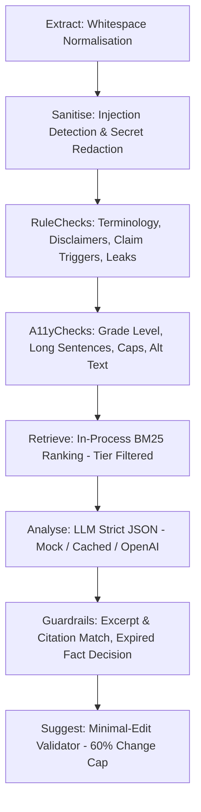

# AI & Review Engine Design

## Principles
1. **Verification, Not Generation**: The model does not author content; it audits claims, tone, and compliance against retrieved brand rules.
2. **Deterministic First, AI Second**: Code handles regex, exact terminology, accessibility, link validity, and confidential leak detection. LLM is invoked only for semantic claims and nuance.
3. **Strict Citation Guardrails**: Any policy finding generated by the LLM must cite an approved entry code retrieved in context. If unverified or cited code is missing, the finding is either dropped or reclassified as a non-policy `general_note`.
4. **Suggest, Never Act**: Suggestions are generated with minimal edit constraints (<60% span change, no ungrounded numbers, no superlatives) and never auto-applied.

## Pipeline Architecture (`app.domain.review`)

The review engine is structured as an ordered pipeline implementing the `Stage` protocol:

### 1. Extract Stage (`ExtractStage`)
- Normalizes newline characters (`\r\n` to `\n`) while preserving character span coordinates.

### 2. Sanitise Stage (`SanitiseStage`)
- Content is treated strictly as untrusted data.
- **Prompt Injection Detection**: Scans for phrases like `ignore previous instructions`, `system override`, `disregard all rules`. Sets `prompt_injection_flagged` flag in context without altering review execution.
- **Redaction Engine**: Masks emails (`[EMAIL_REDACTED_N]`), phone numbers (`[PHONE_REDACTED_N]`), API keys (`[API_KEY_REDACTED_N]`), and confidential launch terms (`[CONFIDENTIAL_REDACTED_N]`).
- Stores placeholder map in memory; logs only counts (`emails`, `phones`, `api_keys`, `secrets`). The raw secret strings are never logged or exported.

### 3. Rule Checks Stage (`RuleChecksStage`)
- Pure Python deterministic rule execution:
  - **Terminology**: Case-insensitive word boundary matching with approved exception lists (e.g., flags "serum", but respects "hair serum").
  - **Disclaimers**: Validates presence of channel-specific disclaimers (e.g., `#LumoPartner` on social posts).
  - **Claim Triggers**: Flags phrases like `clinically proven`, `#1`, `guaranteed`.
  - **Confidential Leaks**: Detects unreleased launch codenames on public/external channels.

### 4. Accessibility & Readability Stage (`A11yChecksStage`)
- **Reading Grade Level**: Computes Flesch-Kincaid grade level from word, sentence, and syllable counts. Flags text exceeding grade 14.
- **Long Sentences**: Flags individual sentences exceeding 35 words.
- **ALL-CAPS Runs**: Flags runs of 3+ consecutive uppercase words.
- **Descriptive Links**: Flags non-informative anchor text like `[click here]`.
- **Markdown Image Alt Text**: Flags `` missing alternative text.
- **Heading Hierarchy**: Flags heading skips (e.g. `# Heading` directly to `### Subheading`).

### 5. Retrieval Stage (`BM25Retriever`)
- In-process Okapi BM25 lexical ranking ($k_1 = 1.5, b = 0.75$).
- **Tier Clearance & Egress Boundary**: Strictly excludes entries classified as `confidential` from LLM context and restricts retrieval to entries within caller's `user_max_tier`.

### 6. Analysis Stage (`AnalyseStage`)
- Prompts LLM using `backend/app/prompts/analysis.v1.md`.
- Uses delimiters `<<<CONTENT_DATA>>>` and `<<</CONTENT_DATA>>>` to isolate untrusted user data.
- Demands strict JSON schema with `claims`, `tone`, and `notes`.
- Supported Adapters:
  - `MockLLMAdapter`: Fully offline, deterministic fixture responses for test samples S1-S5.
  - `CachedLLMAdapter`: Cache decorator keyed by `sha256(content|kb_codes|prompt_version|model)`.
  - `OpenAICompatibleLLMAdapter`: Uses `httpx` with timeout and exponential backoff. Enforces confidentiality assertions before transmission.

### 7. Guardrails Stage (`GuardrailsStage`)
- **Citation Verification**: Drops citations not in the retrieved KB set. Uncited findings are demoted to non-policy `general_note`.
- **Excerpt Verification**: Drops findings whose excerpt does not match an exact substring in the text.
- **Expired Fact Decision in Code**: For cited facts, checks `valid_until` against current date in pure Python code. If expired, forces `claim_verdict = "Expired"`.
- **Confidence Calibration**: If `confidence < 0.6`, marks `needs_human_judgment = True`.
- **Deduplication**: Merges AI findings that replicate exact rule finding spans.

### 8. Suggestion Validator Stage (`SuggestionValidatorStage`)
- **Change Cap**: Rejects suggestions altering more than 60% of the original span.
- **No Ungrounded Numbers**: Rejects suggestions introducing digits or percentages absent from both the original copy and cited evidence.
- **No Superlatives**: Rejects suggestions introducing terms like `best`, `miracle`, `flawless`, `unbeatable`.
- **No Banned Terms**: Rejects suggestions re-introducing terms like `serum` or `cure`.
- If rejected, clears `suggested_fix = None` ("no safe suggestion, needs a human edit").

---

## 9. Review Orchestrator & Application Layer (`app.application.review`)

The `ReviewOrchestrator` coordinates the domain pipeline within the web application:
- **Port/Adapter Decoupling**: Application interacts with storage strictly through `ReviewStorePort` (`backend/app/ports/review_store.py`), implemented by `SqlAlchemyReviewStore` (`backend/app/adapters/db/review_store.py`).
- **Progress Tracking**: Reviews are executed in background tasks (`BackgroundTasks`). Status progression is persisted in the database:
  - `extracting` $\rightarrow$ `rule_checks` $\rightarrow$ `retrieving` $\rightarrow$ `analysing` $\rightarrow$ `finalising` $\rightarrow$ `completed`.
- **Partial Results Survival**: If the LLM analysis stage encounters a network error, timeout, or quota exhaustion, partial rule and accessibility findings are preserved. The review transitions to `completed` with `fallback_reason` and error notes recorded.
- **Workflow State Transition**: Upon review completion, the submission is automatically updated to `Checked`, unlocking creator actions.

---

## 10. Execution Modes & Fallback Matrix

The review engine operates in 4 distinct execution modes:
1. **`mock` (Default)**:
   - Zero outbound HTTP/network calls.
   - Requires no API key.
   - Deterministic findings for test samples S1-S5 and offline heuristic checks.
2. **`rules_only`**:
   - Executes deterministic regex, terminology, disclaimer, and accessibility checks only.
   - Completely skips the LLM retrieval and analysis stages.
3. **`cached`**:
   - Keys call hashes by `sha256(content | kb_codes | prompt_version | model)`.
   - Returns cached LLM completions if present; invokes live LLM on cache misses.
4. **`live`**:
   - Calls external LLM provider (e.g., Gemini via OpenAI-compatible endpoint).
   - Enforces daily quota caps and egress boundary policies.

### Automatic Fallback Matrix
- **Daily Cap Exhaustion**: If today's live LLM calls reach `llm_daily_cap` (stored in settings), the orchestrator automatically falls back to `rules_only`, logging `"Daily LLM quota cap reached; executed deterministic rules only"` in `review.fallback_reason`.
- **Admin "No External AI" Switch**: When enabled in system settings, live calls are immediately blocked, forcing fallback with `"Admin toggle 'no_external_ai' active; executed deterministic rules only"`.
- **Model Timeout / Network Failure**: If an external provider call fails or times out, the review recovers gracefully, recording partial findings and logging the timeout details.

---

## 11. Data Boundary & Telemetry (`GET /reviews/{id}/boundary`)

Every review logs detailed boundary metrics in the `ai_calls` table:
- **Provider & Model**: Actual provider and model invoked.
- **Purpose**: e.g., `"Claims verification and brand tone audit"`.
- **Redaction Summary**: Exact count of masked emails, phone numbers, API keys, and launch secrets.
- **Entry Codes Included**: List of knowledge base codes supplied in the prompt context.
- **Characters Sent**: Exact character count of the prompt payload transmitted out of the network boundary.
- **Highest Tier Sent**: Highest classification tier of content sent (strictly never exceeds `public` or `internal`; `confidential` entries are forbidden from egress).
- **Cache Hit**: Boolean indicating cache reuse.
- **Offline Transparency**: In `mock` mode, the boundary response states plainly:
  `"Offline mock mode: zero data sent to external services."` with `characters_sent = 0` and `external_calls_count = 0`.

