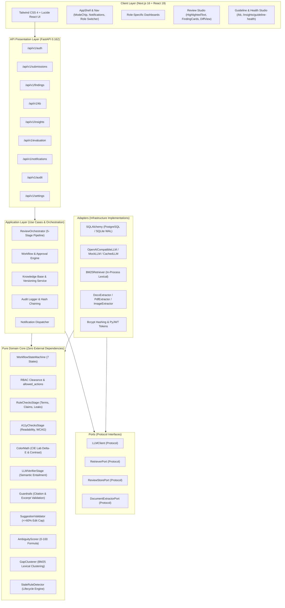
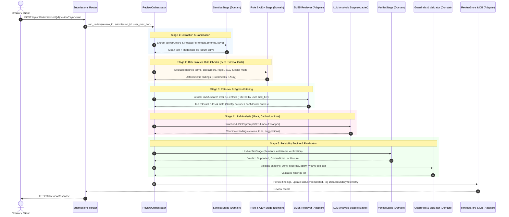

# System Architecture: Inkguard

**Product:** Inkguard — Intelligent Brand Governance Platform  
**Architecture Pattern:** Clean Architecture / Hexagonal (Ports & Adapters) Modular Monolith  
**Status:** Round 3 Release

---

## 1. High-Level Architecture Diagram



---

## 2. Module Boundaries & Dependency Invariants

Inkguard strictly implements **Clean Architecture** with inward-pointing dependencies. Contracts are automatically enforced by `import-linter` via `python manage.py arch`:

1. **`domain/` (Pure Python Core)**:
   - **Constraint**: Must NEVER import from `application`, `adapters`, `api`, or external web/ORM libraries (`fastapi`, `sqlalchemy`, `httpx`, `pydantic_settings`).
   - **Responsibility**: Pure business logic, invariants, scoring algorithms, and domain models.
   - **Verification**: `manage.py arch` verifies `Domain layer purity KEPT`.

2. **`application/` (Use Cases)**:
   - **Constraint**: Must NEVER import from `adapters` or `api`.
   - **Responsibility**: Coordinates domain objects, initiates transactions, executes pipeline stages, and interacts exclusively with interfaces defined in `ports/`.
   - **Verification**: `manage.py arch` verifies `Application layer isolation KEPT`.

3. **`ports/` (Abstract Interfaces)**:
   - **Responsibility**: Defines Python typing `Protocol` definitions (`LLMClient`, `RetrieverPort`, `ReviewStorePort`). Decouples application logic from third-party SDKs and databases.

4. **`adapters/` (Infrastructure)**:
   - **Responsibility**: Implements port interfaces with concrete technologies: SQLAlchemy (Postgres/SQLite), Google AI Studio / Ollama, `python-docx`, `pdfplumber`, `Pillow`, and Bcrypt.

5. **`api/` (Transport)**:
   - **Responsibility**: HTTP routing, request parsing, response serialization, cookie/header extraction, and role authorization gates.

---

## 3. Data Flow of One Review

When a creator clicks **"Run Brand Review"** (or calls `POST /api/v1/submissions/{id}/review`), the submission flows through a deterministic 5-stage orchestration pipeline:



---

## 4. Trust Boundary & Data Privacy Architecture

Inkguard enforces strict data privacy invariants at every architectural layer:

```
+-------------------------------------------------------------------------------+
|                             CLIENT / BROWSER                                  |
+-------------------------------------------------------------------------------+
                                      |
                                      v HTTPS / JWT
+-------------------------------------------------------------------------------+
|                             FASTAPI GATEWAY                                   |
| - Authentication & RBAC Clearance Gate (Tier: Public, Internal, Confidential)  |
| - Input validation (413 on >20,000 chars, 422 on empty content)               |
+-------------------------------------------------------------------------------+
                                      |
                                      v In-Memory Context
+-------------------------------------------------------------------------------+
|                       INGESTION & SANITISATION BOUNDARY                       |
| - SanitiseStage: regex redaction of PII (emails, phones, API keys)           |
| - Redaction log persists type & count only; never raw PII                    |
+-------------------------------------------------------------------------------+
                                      |
                                      v
+-------------------------------------------------------------------------------+
|                       RETRIEVAL & CONFIDENTIAL FILTER                         |
| - In-process BM25 filtered strictly by user max_tier                          |
| - Hard Assert: ZERO confidential entries ever included in external payload    |
+-------------------------------------------------------------------------------+
                                      |
                                      v (Filtered sanitized payload)
+===============================================================================+
|                   EXTERNAL AI BOUNDARY (Google AI Studio / Ollama)            |
| - 30-Second Execution Deadline Wrapper                                        |
| - Admin "No External AI" switch halts all egress                              |
| - Daily Cap (LLM_DAILY_CAP) forces fallback to rules_only                     |
| - Data Boundary Log records exact character egress & clearance tier           |
+===============================================================================+
```

---

## 5. What the Three Major Improvements Added

In Round 3, three major architectural capabilities were added to the platform:

### 1. Reliability Engine
- **LLM Verifier Pass** ([verifier.py](file:///home/redpanda/Documents/WeBug/backend/app/domain/review/verifier.py)):
  - Evaluates candidate findings against cited guidelines using a dedicated semantic entailment prompt (`verify.v1.md`).
  - Automatically drops ungrounded findings and downgrades low-confidence items to `needs_human_judgment=True`.
- **Benchmark Evaluation Harness** ([eval/](file:///home/redpanda/Documents/WeBug/backend/app/eval/)):
  - 84 ground-truth annotated documents across 5 channels (`Social`, `Email`, `Blog`, `Web`, `Press Release`).
  - Automated offline regression metrics CLI (`python manage.py eval`) measuring Precision, Recall, and F1 across mock, cached, and live runs.

### 2. Guideline Health Intelligence
- **Ambiguity Scoring Engine** ([ambiguity.py](file:///home/redpanda/Documents/WeBug/backend/app/domain/insights/ambiguity.py)):
  - Pure Python formula (0–100) scoring rules based on creator dismissal rates, reviewer overrides, team disagreement discordance, and clarification comment volume (requires $\ge 5$ events).
- **Uncited Comment Clustering & Gap Detection** ([gaps.py](file:///home/redpanda/Documents/WeBug/backend/app/domain/insights/gaps.py)):
  - In-process BM25 lexical similarity clustering grouping reviewer change-request comments that do not cite existing rules, generating candidate rule proposals with one-click manager approval into the Knowledge Base.
- **Rule Lifecycle Auditing** ([stale.py](file:///home/redpanda/Documents/WeBug/backend/app/domain/insights/stale.py)):
  - Automated detection of unused rules (8+ weeks), overdue review dates, expired facts, and rules referencing expired facts.

### 3. Multi-Format Review & Visual Brand Compliance
- **Hierarchical Document Ingestion** ([docx_extractor.py](file:///home/redpanda/Documents/WeBug/backend/app/adapters/documents/docx_extractor.py), [pdf_extractor.py](file:///home/redpanda/Documents/WeBug/backend/app/adapters/documents/pdf_extractor.py)):
  - Safe parsing of `.docx` and `.pdf` files, extracting headings, tables, callouts, and tracking location metadata (`"Paragraph 3"`, `"Page 1"`).
- **Computer-Vision Brand Asset Compliance** ([image_extractor.py](file:///home/redpanda/Documents/WeBug/backend/app/adapters/documents/image_extractor.py), [color_math.py](file:///home/redpanda/Documents/WeBug/backend/app/domain/review/color_math.py)):
  - Pure Python CIE Lab Delta-E color distance calculation against brand palette (`PALETTE-001`).
  - Average 64-bit perceptual image hashing for brand logo verification (`ASSET-LOGO-01`).
  - WCAG AA 4.5:1 text/image contrast calculation and graceful degradation when OCR is unavailable.
